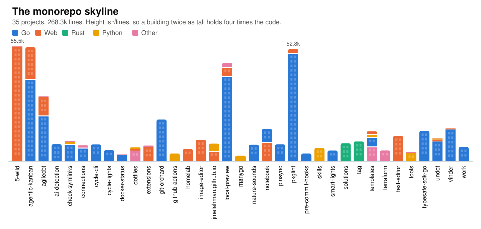

[](https://github.com/jmelahman/monorepo/actions/workflows/pre-commit.yml)
[](https://github.com/jmelahman/monorepo/actions/workflows/dependabot/dependabot-updates)

<picture>
  <source media="(prefers-color-scheme: dark)" srcset="media/skyline-dark.svg">
  
</picture>

## Stable Projects

These projects are still in active development but may be considered "stable".

| Project                                                         | Tests                                                                                                                                                                                    | Deploy                                                                                                                                                                                             |
| --------------------------------------------------------------- | ---------------------------------------------------------------------------------------------------------------------------------------------------------------------------------------- | -------------------------------------------------------------------------------------------------------------------------------------------------------------------------------------------------- |
| [5-wild](https://github.com/jmelahman/5-wild)                   | [](https://github.com/jmelahman/5-wild/actions/workflows/pre-commit.yml)                   | [](https://github.com/jmelahman/5-wild/actions/workflows/pages.yml)                                     |
| [agentic-kanban](https://github.com/jmelahman/agentic-kanban)   | [](https://github.com/jmelahman/agentic-kanban/actions/workflows/pre-commit.yml)   | [](https://github.com/jmelahman/agentic-kanban/actions/workflows/release.yml)                 |
| [check-symlinks](https://github.com/jmelahman/check-symlinks)   | [](https://github.com/jmelahman/check-symlinks/actions/workflows/pre-commit.yml)   | [](https://github.com/jmelahman/check-symlinks/actions/workflows/release.yml)                 |
| [connections](https://github.com/jmelahman/connections)         | [](https://github.com/jmelahman/connections/actions/workflows/pre-commit.yml)         | [](https://github.com/jmelahman/connections/actions/workflows/release.yml)                       |
| [draw](https://github.com/jmelahman/draw)                       |                                                                                                                                                                                          | [](https://github.com/jmelahman/draw/actions/workflows/pages/pages-build-deployment)   |
| [git-orchard](https://github.com/jmelahman/git-orchard)         | [](https://github.com/jmelahman/git-orchard/actions/workflows/pre-commit.yml)         | [](https://github.com/jmelahman/git-orchard/actions/workflows/release.yml)                       |
| [go-bin](https://github.com/jmelahman/go-bin)                   | [](https://github.com/jmelahman/go-bin/actions/workflows/pre-commit.yml)                   | [](https://github.com/jmelahman/go-bin/actions/workflows/release.yml)                                 |
| [local-preview](https://github.com/jmelahman/local-preview)     | [](https://github.com/jmelahman/local-preview/actions/workflows/pre-commit.yml)     | [](https://github.com/jmelahman/local-preview/actions/workflows/release.yml)                   |
| [manygo](https://github.com/jmelahman/manygo)                   | [](https://github.com/jmelahman/manygo/actions/workflows/pre-commit.yml)                   | [](https://github.com/jmelahman/manygo/actions/workflows/release.yml)                                 |
| [nature-sounds](https://github.com/jmelahman/nature-sounds)     | [](https://github.com/jmelahman/nature-sounds/actions/workflows/pre-commit.yml)     | [](https://github.com/jmelahman/nature-sounds/actions/workflows/release.yml)                   |
| [pinsync](https://github.com/jmelahman/pinsync)                 | [](https://github.com/jmelahman/pinsync/actions/workflows/pre-commit.yml)                 | [](https://github.com/jmelahman/pinsync/actions/workflows/release.yml)                               |
| [pkglint](https://github.com/jmelahman/pkglint)                 | [](https://github.com/jmelahman/pkglint/actions/workflows/pre-commit.yml)                 | [](https://github.com/jmelahman/pkglint/actions/workflows/release.yml)                               |
| [skills](https://github.com/jmelahman/skills)                   | [](https://github.com/jmelahman/skills/actions/workflows/pre-commit.yml)                   |                                                                                                                                                                                                    |
| [tag](https://github.com/jmelahman/tag)                         | [](https://github.com/jmelahman/tag/actions/workflows/pre-commit.yml)                         | [](https://github.com/jmelahman/tag/actions/workflows/release.yml)                                       |
| [typesafe-sdk-go](https://github.com/jmelahman/typesafe-sdk-go) | [](https://github.com/jmelahman/typesafe-sdk-go/actions/workflows/pre-commit.yml) |                                                                                                                                                                                                    |
| [undot](https://github.com/jmelahman/undot)                     | [](https://github.com/jmelahman/undot/actions/workflows/pre-commit.yml)                     | [](https://github.com/jmelahman/undot/actions/workflows/release.yml)                                   |
| [vinder](https://github.com/jmelahman/vinder)                   | [](https://github.com/jmelahman/vinder/actions/workflows/pre-commit.yml)                   | [](https://github.com/jmelahman/vinder/actions/workflows/release.yml)                                 |
| [write](https://github.com/jmelahman/write)                     |                                                                                                                                                                                          | [](https://github.com/jmelahman/write/actions/workflows/pages/pages-build-deployment) |

## Unfinished Projects

- [AgileCBT](https://github.com/jmelahman/AgileCBT)
- [cycle-cli](https://github.com/jmelahman/cycle-cli)
- [docker-status](https://github.com/jmelahman/docker-status)
- [local-ai-detection](https://github.com/jmelahman/local-ai-detection)
- [notebook](https://github.com/jmelahman/notebook)
- [smart-lights](https://github.com/jmelahman/smart-lights)
- [work](https://github.com/jmelahman/work)

## Browser Extensions

- [extensions/github-token-diff-extension](https://github.com/jmelahman/github-token-diff-extension)

## Pre-commit Hooks

- [pre-commit-hooks/go-pre-commit-hooks](https://github.com/jmelahman/go-pre-commit-hooks)

## GitHub Actions

- [github-actions/claude-security-review](https://github.com/jmelahman/claude-security-review)

## Templates

- [templates/fullstack-template](https://github.com/jmelahman/fullstack-template)
- [templates/godot-template](https://github.com/jmelahman/godot-template)
- [templates/golang-template](https://github.com/jmelahman/golang-template)
- [templates/PKGBUILDs-template](https://github.com/jmelahman/PKGBUILDs-template)

## Other

- [dotfiles](https://github.com/jmelahman/dotfiles)
- [jmelahman.github.io](https://github.com/jmelahman/jmelahman.github.io)

## Subtrees

Most projects are tracked as [git-subtrees](https://github.com/git/git/blob/master/contrib/subtree/git-subtree.txt).
This allows them to be developed uniformly while leaving operational tasks, such as deployments, independent.

Subtrees and their repositories are listed in [`.config/git-orchard/subtrees`](.config/git-orchard/subtrees) and managed with [git-orchard](git-orchard):

```shell
git orchard status          # ahead/behind each upstream
git orchard pull [prefix…]  # merge upstream changes (squashed)
git orchard push [prefix…]  # publish, fast-forward only
git orchard add <prefix> git@github.com:jmelahman/<name>.git
```

On every push to `master`, [`mirror.yml`](.github/workflows/mirror.yml) runs `git orchard push` for each changed subtree.
Mirror pushes are fast-forward only: if an upstream has commits the monorepo doesn't (e.g. a merged PR), `git orchard pull` it in before the next push.

Releases are tagged in the monorepo as `<prefix>/v<version>`; the mirror job publishes the tag upstream as `v<version>`, which triggers that repository's release workflow.

```shell
git orchard release connections          # tags the next patch version, e.g. connections/v1.2.4, and pushes it
git orchard release connections --minor  # or --major, --suffix rc, or an explicit version like v1.3.0
```

The subtrees' repositories (and the monorepo's own) are configured by [`terraform/github`](terraform/github), which reads the same `subtrees` file.

```shell
cd terraform/github
GITHUB_TOKEN=$(gh auth token) terraform plan
```

To add a subtree:

1. Add it to `subtrees`: `git orchard add`.
2. Give it a description and topics under `overrides` in [`repositories.tf`](terraform/github/repositories.tf), then `terraform apply`.

New Go modules also go in `go.work`.

# Tooling

## Upgrading

### Hooks

```shell
prek update --freeze
```

The [pinsync](pinsync) hook then rewrites every copy of a version pinned in [`.config/pinsync/config.toml`](.config/pinsync/config.toml) on the next `prek run`.
It holds git-orchard's hook rev and prek's CI version at what `uv.lock` locks, so bump those there instead:

```shell
uv lock --upgrade-package git-orchard
uv lock --upgrade-package prek
```

### Golang

```shell
prek run --stage manual go-get
```

This runs `go get -u ./...` from each module's root, in every module whose config includes the `go-get` hook.

## Checks

Linting, formatting and type-checking run as [prek](https://prek.j178.dev) hooks (see `.pre-commit-config.yaml`), with tools pinned by the config or `uv.lock` rather than taken from the host.

```shell
prek install        # once per clone
prek run            # staged files
prek run --all-files
```

The monorepo is a prek [workspace](https://prek.j178.dev/workspace/): each project's own `.pre-commit-config.yaml` runs from that project's directory, and the root config also runs on every file in the tree.
Module-scoped Go checks (`go vet`, `go test`, `golangci-lint`, ...) live in each module's config, since they have to run from a module root.
