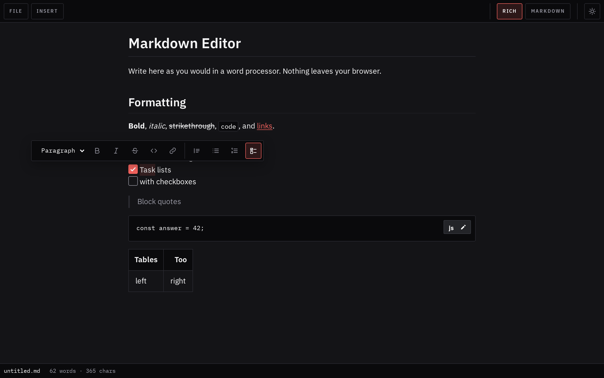

# text-editor

A WYSIWYG Markdown editor that runs entirely in the browser. No build step,
and nothing leaves your machine.



## Features

- Rich editing of the formatted document, or the Markdown source beside a live preview
- Headings, emphasis, strikethrough, code, links, images, quotes, lists, task lists, and tables
- Formatting from a bar that appears over the selected text; tables, code blocks, and dividers from the Insert menu
- Markdown typed in rich mode is converted as you go: `## `, `* `, `> `, `` ``` ``
- Open a file from disk or by drag-and-drop; dropped or pasted images are embedded
- Save back to the opened file where the browser supports it, or download a copy
- Reopen recent files from the File menu, in browsers that can save back to a file
- Export a standalone HTML page, or copy the document as rich text
- The current document is kept as a draft in the browser and restored on the next visit
- Light and dark themes, following the system until one is chosen

## Shortcuts

| Key                       | Action                                 |
| ------------------------- | -------------------------------------- |
| `Ctrl+B` / `Ctrl+I`       | Bold / italic                          |
| `Ctrl+K`                  | Link                                   |
| `Tab` / `Shift+Tab`       | Indent / outdent a list item           |
| `Ctrl+Z` / `Ctrl+Shift+Z` | Undo / redo                            |
| `Ctrl+O`                  | Open                                   |
| `Ctrl+S` / `Ctrl+Shift+S` | Save / save as                         |

Right-click a table cell to add, remove, or align rows and columns.

## Caveats

Rich mode keeps the document as a tree, not as text, and writes Markdown back
out in its own style. A file opened and saved there can change where nothing
was edited: `-` bullets become `*`, `_emphasis_` becomes `*emphasis*`, tables
are realigned, and reference-style link definitions are not preserved.
Markdown mode leaves the source as typed, for as long as the document stays
in it.

Raw HTML is the exception. Front matter, comments, common blocks (`<div>`,
`<details>`, `<svg>`, and the like), and inline tags such as `<kbd>` and
`<sub>` are shown in rich mode and written back exactly as they were. A block
can be moved or deleted there, but only edited in Markdown mode. A document
with any other HTML opens in Markdown mode, and switching it to rich mode
asks first, as that would leave only the text.

SVG is drawn without styles, scripts, gradients, or embedded HTML.

Images with a remote address are fetched by the browser when shown. Relative
image paths do not resolve, as the page cannot see the folder a file came
from.

## Dependencies

Editing is done by [TOAST UI Editor](https://github.com/nhn/tui.editor) 3.2.2
(MIT), vendored unmodified in `vendor/toastui-editor`. Its usage statistics
are switched off, and its HTML sanitizer is replaced by the allowlist in
`app.js`.

## Development

Open `index.html` in a browser, or serve the directory:

```sh
python -m http.server
```
